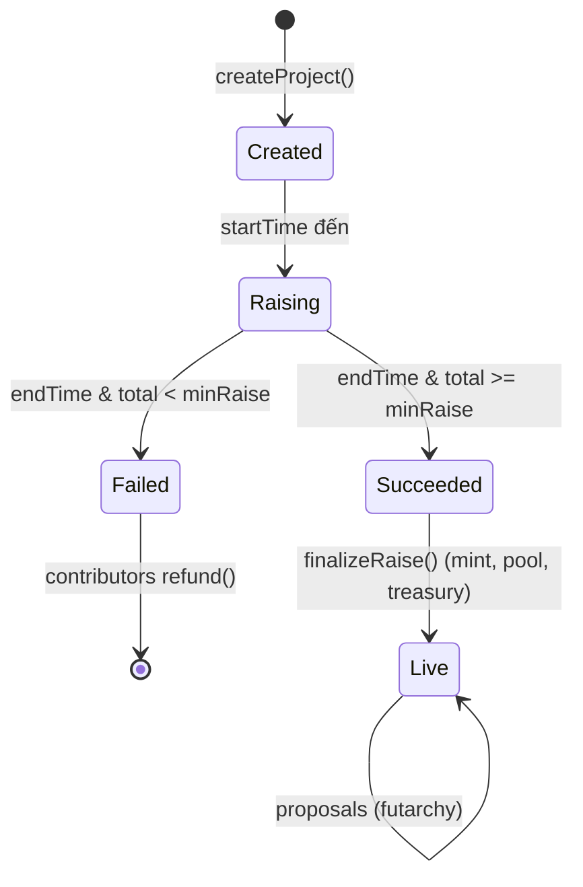
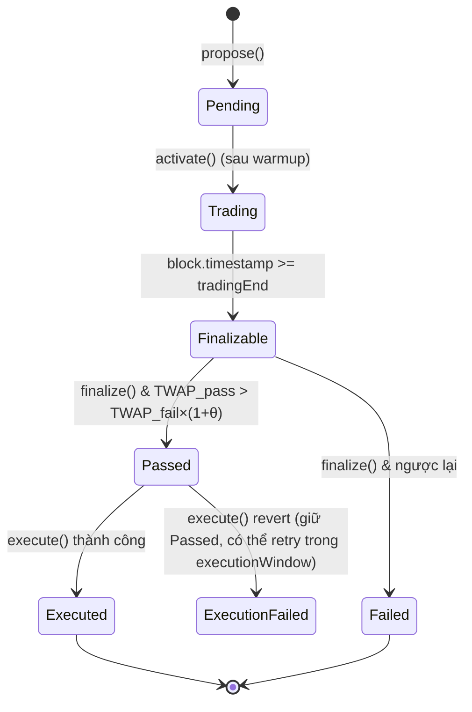

# 02 — Cơ chế kinh tế & Futarchy

File này là **nguồn sự thật về toán học và luật chơi**. Mọi số liệu đều ghi rõ đơn vị và độ chính xác (decimals).

Quy ước:
- `USDC` có 6 decimals. Project token (`TOKEN`) có 18 decimals.
- Giá luôn được biểu diễn là **USDC trên 1 TOKEN**, dạng fixed-point `1e18` (`PRICE_PRECISION = 1e18`), sau khi đã chuẩn hóa chênh lệch decimals.
- `bps`: basis points, 10.000 bps = 100%.

---

## 1. Vòng đời một Project



## 2. Raise (gọi vốn)

### 2.1. Tham số

| Tham số | Kiểu | Mô tả | Ví dụ |
|---|---|---|---|
| `minRaise` | uint256 (USDC) | Mức tối thiểu. Không đạt thì toàn bộ được refund | 50,000 |
| `hardCap` | uint256 (USDC) | Mức tối đa được chấp nhận | 200,000 |
| `startTime`, `endTime` | uint64 | Thời gian raise | 3 ngày (demo: 10 phút) |
| `minContribution` | uint256 | Góp tối thiểu mỗi lần | 10 USDC |
| `totalSupply` | uint256 | Tổng cung token cố định | 10,000,000 TOKEN |
| `allocation` | struct (bps) | Phân bổ token (xem 2.3) | |
| `liquidityUsdcBps` | uint16 | % USDC đã chấp nhận dùng làm thanh khoản spot | 2000 (20%) |
| `monthlyBudget` | uint256 (USDC) | Ngân sách vận hành founder được rút mỗi 30 ngày | 5,000 |

### 2.2. Phân bổ pro-rata khi vượt cap

Gọi `D_i` là tổng tiền người i đã góp, `T = Σ D_i`.

- Nếu `T ≤ hardCap`: `accepted_i = D_i`, `refund_i = 0`, `A = T`.
- Nếu `T > hardCap`: `accepted_i = floor(D_i × hardCap / T)`, `refund_i = D_i − accepted_i`, `A = Σ accepted_i ≤ hardCap`. Phần dư do làm tròn (bụi) được chuyển vào treasury.

Token người i nhận:

```
tokens_i = floor(accepted_i × saleTokens / A)
```

Giá raise hiệu dụng: `P_raise = A / saleTokens` (USDC/TOKEN).

> **Lưu ý triển khai:** không lặp qua danh sách người góp, vì sẽ tốn gas không giới hạn. Mỗi người tự gọi `claim()` sau khi finalize, và contract tính `accepted_i` theo công thức trên từ `D_i`, `T`, `hardCap`.

### 2.3. Phân bổ token mặc định

| Phần | bps mặc định | Đi đâu |
|---|---|---|
| `saleBps` | 5000 (50%) | Chia cho backer theo 2.2 |
| `liquidityBps` | 1500 (15%) | Ghép với `liquidityUsdcBps × A` USDC để seed pool spot |
| `treasuryBps` | 2000 (20%) | Treasury, chỉ chi qua futarchy |
| `founderBps` | 1500 (15%) | `PerformancePackage`, mở khóa theo cột mốc giá |

Ràng buộc: tổng các phần = 10.000 bps.

**Giá khởi điểm của pool spot** = `(liquidityUsdcBps × A / 10000) / liquidityTokens`. Phải đảm bảo giá này ≥ `P_raise` để backer không bị pha loãng ngay khi pool mở. Contract kiểm tra điều kiện này lúc `createProject`, dựa trên giả định raise đạt đúng `hardCap`. Đồng thời lúc finalize, nếu `A < hardCap` thì số token đưa vào pool được scale xuống tương ứng để giữ đúng giá `P_raise × (1 + liquidityPremiumBps)`. Phần token dư chuyển về treasury.

Công thức chốt tại finalize:

```
usdcForPool    = A × liquidityUsdcBps / 10000
poolPrice      = P_raise × (10000 + liquidityPremiumBps) / 10000      // premium mặc định 0
tokensForPool  = usdcForPool / poolPrice   (min với liquidityTokens)
treasuryUsdc   = A − usdcForPool
treasuryTokens = treasuryBps×supply/10000 + (liquidityTokens − tokensForPool)
```

### 2.4. Performance package của founder

Token founder bị khóa và mở theo **tranche** khi **TWAP của pool spot** (đo trong cửa sổ ≥ 3 ngày, demo: 5 phút) đạt các mốc:

| Tranche | Điều kiện | Mở khóa |
|---|---|---|
| 1 | TWAP ≥ 2 × P_raise | 25% |
| 2 | TWAP ≥ 4 × P_raise | 25% |
| 3 | TWAP ≥ 8 × P_raise | 25% |
| 4 | TWAP ≥ 16 × P_raise | 25% |

Thêm điều kiện: tranche không mở trước `cliff` (mặc định 180 ngày, demo: 0). Ý nghĩa: founder chỉ giàu khi token thật sự tăng giá bền vững, không thể bán xả sớm.

### 2.5. Ngân sách vận hành (monthly budget)

- Founder (địa chỉ `operator`) gọi `Treasury.claimBudget()`. Mỗi kỳ 30 ngày (demo: 2 phút) được rút tối đa `monthlyBudget` USDC.
- Kỳ chưa rút **không cộng dồn**.
- `monthlyBudget` và `operator` chỉ thay đổi được qua proposal futarchy.
- Lý do: founder cần tiền vận hành mà không phải tạo proposal cho từng khoản nhỏ. Khoản lớn thì bắt buộc qua thị trường.

---

## 3. Proposal

### 3.1. Vòng đời



- Mỗi project chỉ có **tối đa 1 proposal ở trạng thái Pending/Trading/Finalizable** tại một thời điểm. Điều này tránh trường hợp hai proposal cùng chi một khoản tiền.
- Trạng thái `Pending` kéo dài `warmup` (mặc định 1 giờ, demo: 30 giây) để mọi người đọc proposal trước khi market mở.

### 3.2. Nội dung proposal

```
Proposal {
  title, descriptionURI (IPFS/HTTPS JSON), descriptionHash
  actions: Action[]   // { target, value, data } – Treasury sẽ call lần lượt
  proposer, bondAmount
  initialLiquidity: { usdc, token }
}
```

Các loại action được hỗ trợ ở UI (vẫn là calldata tổng quát ở contract):

| Loại | Target | Hàm |
|---|---|---|
| Chuyển USDC | Treasury | `transferERC20(USDC, to, amount)` |
| Chuyển TOKEN | Treasury | `transferERC20(TOKEN, to, amount)` |
| Đổi ngân sách tháng | Treasury | `setMonthlyBudget(amount)` |
| Đổi operator | Treasury | `setOperator(addr)` |
| Đổi tham số futarchy | Governor | `setParams(...)` |
| Thực thi trên L1 | GovernanceMessenger | `sendToL1(l1ChainId, payload)` (file 06) |

### 3.3. Bond và thanh khoản ban đầu

- **Bond:** proposer khóa `proposalBond` TOKEN (mặc định 0.5% supply). Bond được hoàn lại sau khi finalize, dù kết quả là gì. Bond chỉ bị **slash** (chuyển vào treasury) nếu proposal bị `cancel` bởi chính proposer sau khi market đã mở. Mục đích là chống spam.
- **Thanh khoản ban đầu:** proposer phải cung cấp `minLiquidityUsdc` USDC (production mặc định 1.000; demo 50.000 theo flow map hiện hành) và lượng TOKEN tương ứng theo **giá TWAP spot hiện tại**. Số tiền này được split thành conditional token để seed **cả hai pool với cùng một giá**. Proposer nhận lại LP sau khi finalize.

> Vì sao seed hai pool cùng giá? Để thị trường bắt đầu từ trạng thái "trung lập". Chênh lệch giữa hai pool chỉ xuất hiện khi trader có thông tin.

---

## 4. Conditional Vault (token có điều kiện)

Với mỗi proposal, mỗi tài sản nền (`USDC`, `TOKEN`) có một vault riêng.

| Thao tác | Input | Output | Điều kiện |
|---|---|---|---|
| `split(amount)` | `amount` underlying | `amount` pX + `amount` fX | Proposal chưa resolve |
| `merge(amount)` | `amount` pX + `amount` fX | `amount` underlying | Bất kỳ lúc nào trước khi resolve |
| `redeem()` | toàn bộ pX (nếu Pass) hoặc fX (nếu Fail) | underlying 1:1 | Đã resolve |

**Invariant:** `underlying.balanceOf(vault) == pX.totalSupply() == fX.totalSupply()` trước khi resolve. Sau khi resolve: `underlying.balanceOf(vault) >= winningToken.totalSupply()`.

Ý nghĩa kinh tế:
- 1 pUSDC = "1 USDC nếu Pass, 0 nếu Fail".
- Giá `pTOKEN` tính bằng `pUSDC` = **giá TOKEN kỳ vọng với điều kiện proposal Pass**.
- Giá `fTOKEN/fUSDC` = giá kỳ vọng với điều kiện Fail.
- So sánh hai giá này chính là câu hỏi: "Proposal này làm token đáng giá hơn hay kém đi?"

---

## 5. AMM (Decision Market)

Mỗi proposal có 2 pool **constant product** (giống Uniswap V2, không có concentrated liquidity):
- Pass pool: base = `pTOKEN`, quote = `pUSDC`
- Fail pool: base = `fTOKEN`, quote = `fUSDC`

Pool spot của project (`TOKEN/USDC`) dùng **cùng contract AMM** đó.

### 5.1. Công thức swap

Reserve `x` (base), `y` (quote), phí `φ` (bps, mặc định 30 = 0.3%).

Mua base bằng `Δy` quote:
```
Δy_eff = Δy × (10000 − φ) / 10000
Δx_out = x × Δy_eff / (y + Δy_eff)
```
Bán `Δx` base lấy quote:
```
Δx_eff = Δx × (10000 − φ) / 10000
Δy_out = y × Δx_eff / (x + Δx_eff)
```
Phí ở lại trong pool (tăng k), thuộc về LP.

Giá spot (đã chuẩn hóa decimals):
```
spotPrice = y × 10^(18 − 6) × 1e18 / x        // USDC 6 dec, TOKEN 18 dec, kết quả 1e18-fixed
```
(Trong conditional pool, pUSDC/fUSDC giữ 6 decimals, pTOKEN/fTOKEN giữ 18 decimals, nên công thức không đổi.)

### 5.2. Slippage protection

Mọi hàm swap nhận `minAmountOut` và `deadline`.

### 5.3. LP

- Chỉ hỗ trợ **full-range LP** (share token nội bộ, không cần ERC20 LP token riêng cho conditional pool).
- Conditional pool: chỉ proposer (seed) và bất kỳ ai muốn thêm thanh khoản trong giai đoạn Trading. **Không cho rút LP trước khi finalize**, để chống rút thanh khoản phút chót làm méo giá.

---

## 6. Lagging TWAP Oracle (chống thao túng)

TWAP thông thường tính trung bình giá spot theo thời gian. Nhưng kẻ tấn công có thể đẩy giá cực mạnh trong một block (flash) và vẫn làm lệch trung bình. Futara dùng **"lagging" TWAP**: giá quan sát (observation) chỉ được phép đi theo giá spot với **tốc độ giới hạn**.

### 6.1. Tham số

| Tham số | Production | Demo | Ý nghĩa |
|---|---|---|---|
| `tradingPeriod` | 3 ngày | 15 phút | Thời gian market mở |
| `twapStartDelay` | 1 ngày | 3 phút | Bỏ qua giai đoạn đầu (khám phá giá) khi tính TWAP |
| `minUpdateInterval` | 60 giây | 10 giây | Khoảng cách tối thiểu giữa 2 lần cập nhật observation |
| `maxObservationChangePerUpdate` | 1% × giá seed (tuyệt đối) | 2% × giá seed | Observation thay đổi tối đa bao nhiêu mỗi lần cập nhật |
| `thresholdBps` (θ) | 300 (3%) | 300 | Biên Pass |

### 6.2. Thuật toán cập nhật

State mỗi pool: `lastObservation` (1e18), `lastUpdateTime`, `aggregator` (Σ observation × Δt, uint256), `aggregatorStartTime`.

Hàm `_updateTwap()` được gọi **trước mỗi swap** và trong hàm public `crank()`:

```
if block.timestamp < lastUpdateTime + minUpdateInterval: return
spot = currentSpotPrice()
maxDelta = maxObservationChangePerUpdate
if spot > lastObservation:  newObs = min(spot, lastObservation + maxDelta)
else:                       newObs = max(spot, lastObservation − maxDelta)

t0 = max(lastUpdateTime, twapStart)          // twapStart = tradingStart + twapStartDelay
if block.timestamp > twapStart:
    aggregator += newObs × (block.timestamp − t0)    // tích phân hình chữ nhật dùng giá trị mới
lastObservation = newObs
lastUpdateTime  = block.timestamp
```

Khi `finalize()`, contract gọi `_updateTwap()` một lần cuối (bỏ qua `minUpdateInterval`), rồi tính:

```
TWAP = aggregator / (tradingEnd − twapStart)
```

**Vì sao chống thao túng tốt?**
- Một lần đẩy giá chỉ làm observation nhích tối đa `maxDelta`. Muốn kéo TWAP lệch đáng kể, kẻ tấn công phải **giữ giá lệch liên tục nhiều giờ**.
- Trong suốt thời gian đó, arbitrageur (bao gồm agent của Futara) sẽ trade ngược lại và **ăn tiền của kẻ tấn công**.
- Chi phí tấn công tăng tuyến tính theo thời gian và theo thanh khoản pool.

> Observation được ghi kể cả khi không ai swap, nhờ **keeper gọi `crank()`** mỗi phút (xem file 07). Nếu không ai crank, khoảng trống được bù bằng `lastObservation` khi cập nhật lần sau (tích phân với `newObs`, vốn bị giới hạn bởi `maxDelta`). Đây là xấp xỉ chấp nhận được.

---

## 7. Luật quyết định (Decision rule)

```
PASS  ⇔  TWAP_pass × 10000 > TWAP_fail × (10000 + thresholdBps)
FAIL  ⇔  ngược lại
```

- θ > 0 tạo **thiên hướng giữ nguyên hiện trạng** (status quo bias). Một proposal chỉ được thông qua khi thị trường tin chắc nó tốt hơn ít nhất 3%.
- Pass thì vault ghi `outcome = PASS`, Governor gọi `Treasury.execute(actions)`.
- Thực thi trong `executionWindow` (mặc định 3 ngày, demo: 5 phút). Nếu revert, ai cũng có thể retry. Hết hạn mà chưa thành công thì trạng thái thành `ExecutionFailed` (outcome market vẫn là PASS để không phá vỡ redeem).

---

## 8. Ví dụ số hoàn chỉnh

Project EDU: supply 10.000.000, raise A = 200.000 USDC, saleTokens = 5.000.000 → `P_raise` = 0.04 USDC.

Proposal "chi 30.000 USDC cho marketing". Proposer seed 1.000 USDC + 25.000 EDU (giá spot 0.04):
- Split → 1.000 pUSDC + 1.000 fUSDC, 25.000 pEDU + 25.000 fEDU.
- Pass pool: x = 25.000 pEDU, y = 1.000 pUSDC → giá 0.04. Fail pool: giống hệt.

Agent A tin proposal tốt. Agent A split 500 USDC → 500 pUSDC + 500 fUSDC, rồi dùng 500 pUSDC mua pEDU:
- Δy_eff = 500 × 0.997 = 498.5. Δx = 25.000 × 498.5 / 1.498,5 ≈ 8.316,6 pEDU.
- Pass pool mới: x ≈ 16.683,4, y = 1.500 → giá ≈ 0.0899.

500 fUSDC còn lại không dùng được để mua pEDU. Agent A có thể giữ nguyên (nếu Fail thì lấy lại 500 USDC, hòa vốn) hoặc dùng nó trade ở fail pool theo nhận định riêng cho kịch bản Fail. Trader B bi quan về proposal, tức tin giá Pass sẽ **thấp hơn** giá Fail. B split EDU thành pEDU + fEDU rồi **bán pEDU** (đẩy giá Pass xuống), và/hoặc split USDC rồi **mua fEDU** (đẩy giá Fail lên).

Sau giai đoạn trading: TWAP_pass = 0.071, TWAP_fail = 0.038. So sánh: 0.071 × 10000 = 710 > 0.038 × 10300 = 391.4 → **PASS**.

---

## 9. Bảng tổng hợp tham số mặc định

| Nhóm | Tham số | Production | Demo |
|---|---|---|---|
| Raise | duration | 3 ngày | 10 phút |
| Raise | minContribution | 10 USDC | 1 USDC |
| Proposal | warmup | 1 giờ | 30 giây |
| Proposal | tradingPeriod | 3 ngày | 15 phút |
| Proposal | twapStartDelay | 1 ngày | 3 phút |
| Proposal | executionWindow | 3 ngày | 5 phút |
| Proposal | proposalBond | 0,5% supply | 0,1% supply |
| Proposal | minLiquidityUsdc | 1.000 USDC | 50.000 USDC |
| TWAP | minUpdateInterval | 60 giây | 10 giây |
| TWAP | maxObservationChangePerUpdate | 1% giá seed | 2% giá seed |
| Decision | thresholdBps | 300 | 300 |
| AMM | feeBps | 30 | 30 |
| Budget | period | 30 ngày | 2 phút |
| Founder | cliff | 180 ngày | 0 |
| Founder | twapWindow cho milestone | 3 ngày | 5 phút |

Bộ tham số được truyền vào `FutaraFactory.createProject` dưới dạng struct `FutarchyParams`, nên chế độ demo/production chỉ là chọn preset.
