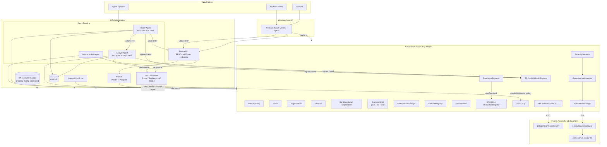
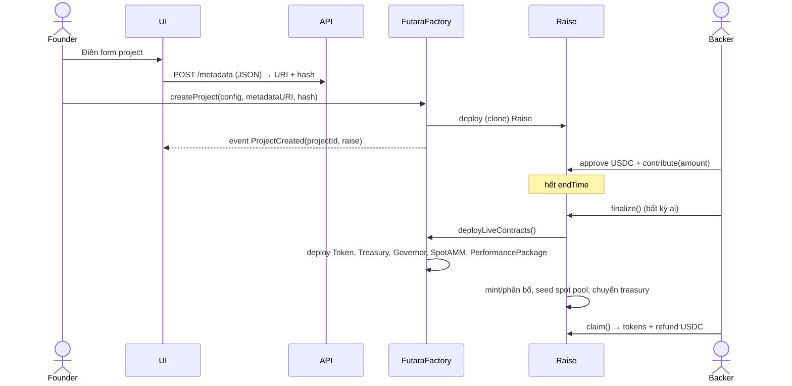
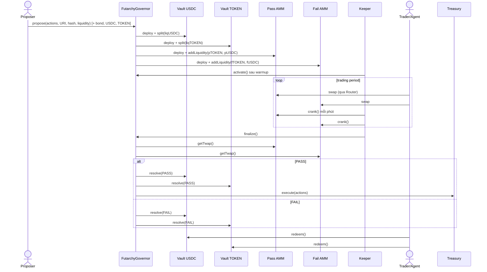
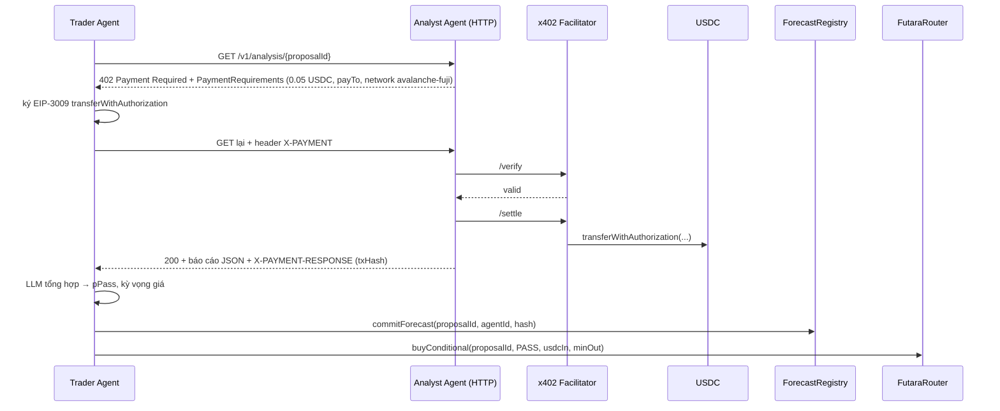
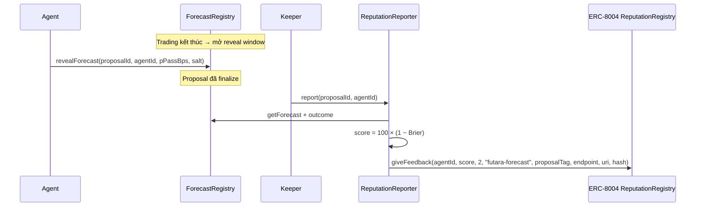

# 03 — Kiến trúc hệ thống

## 1. Sơ đồ tổng thể

## 2. Danh sách thành phần

| # | Thành phần | Loại | Trách nhiệm | Chi tiết |
|---|---|---|---|---|
| 1 | Smart contracts core | Solidity | Launchpad, futarchy, AMM, TWAP, treasury | file 04 |
| 2 | Agent contracts | Solidity | ForecastRegistry, ReputationReporter (gọi ERC-8004) | file 04, 05 |
| 3 | Cross-chain contracts | Solidity | GovernanceMessenger, L1GovernanceExecutor, ICTT | file 06 |
| 4 | Indexer | TypeScript (Ponder) | Đọc event, build bảng truy vấn, tính dữ liệu biểu đồ | file 07 |
| 5 | Futara API | TypeScript (Hono) | REST cho frontend, endpoint x402 trả phí, upload metadata | file 07 |
| 6 | Keeper | TypeScript | Crank TWAP, activate/finalize/execute proposal, report reputation | file 07 |
| 7 | Agent runtime | TypeScript | 3 loại agent, ví riêng, LLM, x402 client & server | file 05 |
| 8 | Web app | Next.js | Toàn bộ UI | file 08 |
| 9 | Storage | IPFS (Pinata/web3.storage) hoặc S3 | Proposal JSON, project metadata, agent registration file, báo cáo phân tích | file 07 |

## 3. Nguyên tắc kiến trúc

1. **On-chain là nguồn sự thật.** Mọi quyết định và luồng tiền nằm on-chain. Indexer/API chỉ là cache để đọc nhanh, nếu mất thì có thể dựng lại từ event.
2. **Mọi hàm "đẩy trạng thái" đều permissionless.** Ví dụ `crank`, `activate`, `finalize`, `execute`, `reportForecast`. Keeper chỉ là tiện ích, không phải điểm tin cậy.
3. **Agent là người dùng bình thường.** Agent không có quyền đặc biệt nào trong contract. Agent tương tác như mọi EOA khác. Danh tính ERC-8004 chỉ dùng để gắn reputation.
4. **Không lưu private key người dùng.** Web app dùng ví (Core, MetaMask, Rabby) qua wagmi. Agent dùng private key riêng trong env/secret manager.
5. **Hash mọi metadata off-chain.** `descriptionHash = keccak256(json bytes)` được lưu on-chain để chống sửa nội dung proposal sau khi đăng.

## 4. Luồng chính (sequence diagrams)

### 4.1. Tạo project và raise

Nếu `total < minRaise` thì `finalize()` chuyển trạng thái sang `Failed` và backer gọi `refund()`.

### 4.2. Proposal và thị trường quyết định

### 4.3. Agent mua phân tích qua x402 và trade

### 4.4. Chấm reputation sau khi resolve

### 4.5. Thực thi xuyên chain (L1)

Xem file 06. Tóm tắt: proposal có action `GovernanceMessenger.sendToL1(...)`. Khi PASS, Treasury gọi action này, Messenger gửi message qua `TeleporterMessenger`. Relayer (ICM relayer) chuyển message sang L1, và `L1GovernanceExecutor.receiveTeleporterMessage` kiểm tra nguồn rồi thực thi trên L1.

## 5. Mô hình tin cậy (trust model)

| Thành phần | Có cần tin không? | Nếu nó "xấu" thì sao |
|---|---|---|
| Contracts | Tin code (đã test) | Bug → mất tiền. Giảm thiểu bằng test và invariant |
| Keeper | Không | Không chạy → ai cũng gọi được hàm thay. TWAP kém mượt nhưng vẫn đúng logic |
| Indexer/API | Không (chỉ hiển thị) | Hiển thị sai → user vẫn ký tx với dữ liệu on-chain thật. UI nên đọc trực tiếp contract cho các số quan trọng (giá, số dư) |
| x402 Facilitator | Tin một phần | Facilitator chỉ có thể submit đúng authorization đã ký (đúng số tiền, đúng người nhận). Rủi ro: không settle → seller không nhận tiền |
| LLM | Không | Agent sai → mất tiền của chính agent. Reputation phản ánh điều đó |
| ICM relayer | Không cho tính đúng đắn (message được ký bởi validator của chain nguồn qua Avalanche Warp Messaging) | Relayer không chạy → message chậm, có thể tự chạy relayer |

## 6. Môi trường

| Môi trường | Chain | Mục đích |
|---|---|---|
| `local` | Anvil (fork Fuji) | Dev + test contract, có ERC-8004 & USDC từ fork |
| `fuji` | Avalanche Fuji C-Chain (43113) + 1 L1 testnet | Demo, nộp bài |

Thông tin mạng Fuji:
- RPC: `https://api.avax-test.network/ext/bc/C/rpc`
- Chain ID: `43113`, CAIP-2: `eip155:43113`, x402 network string: `avalanche-fuji`
- Explorer: `https://testnet.snowtrace.io` hoặc Avalanche Explorer trên Builder Hub
- Faucet AVAX: Builder Hub faucet. Faucet USDC: Circle faucet (`faucet.circle.com`)
