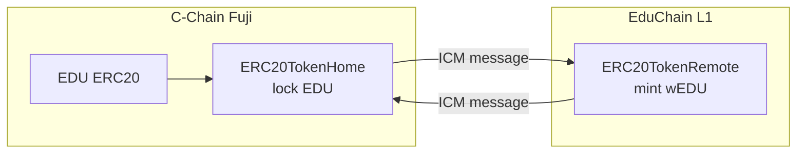

# 06 — Tích hợp Avalanche: L1, ICM (Teleporter), ICTT

Mục tiêu file này là **ăn điểm tiêu chí "Usage of Avalanche technologies"** bằng một use case có ý nghĩa thật, không chỉ để trang trí:

> **Futara là "governance hub" trên C-Chain. Các dự án vận hành sản phẩm trên Avalanche L1 riêng có thể dùng futarchy trên C-Chain để quyết định các thay đổi trên L1 của họ.**

Ví dụ: một dự án game có L1 riêng muốn đổi phí giao dịch trong game, phân bổ reward pool, hoặc nâng cấp contract trên L1. Proposal được trade trên C-Chain (nơi có thanh khoản USDC và các agent). Khi PASS, quyết định được gửi qua ICM để thực thi tự động trên L1.

## 1. Các công nghệ dùng

| Công nghệ | Dùng để | Ghi chú |
|---|---|---|
| **Avalanche C-Chain (Fuji)** | Toàn bộ core: launchpad, futarchy, agent registry | chainId 43113 |
| **Avalanche L1** | Chain riêng cho 1 dự án demo ("EduChain L1"), có thể dùng token dự án làm gas | Tạo bằng Builder Hub Console hoặc Avalanche CLI |
| **ICM / Teleporter** | Gửi message "thực thi quyết định" từ C-Chain sang L1 | Dựa trên Avalanche Warp Messaging, cần ICM relayer |
| **ICTT** | Bridge project token từ C-Chain sang L1 | `ERC20TokenHome` (C-Chain) ↔ `ERC20TokenRemote` hoặc `NativeTokenRemote` (L1) |

## 2. Tạo L1 demo

### 2.1. Cấu hình đề xuất
| Mục | Giá trị |
|---|---|
| Tên | `educhain` |
| VM | Subnet-EVM |
| Chain ID | 7777xx (tự chọn, không trùng với chain đã có) |
| Validator management | Proof of Authority (đơn giản cho demo) |
| Gas token | Native token riêng (`EDUGAS`), hoặc dùng EDU bridge qua `NativeTokenRemote` (nâng cao) |
| Precompiles | Bật **Warp** (bắt buộc cho ICM). Tùy chọn: `txAllowList`, `feeManager` |
| Teleporter | Deploy sẵn khi tạo chain (Console/CLI hỗ trợ) |

### 2.2. Cách tạo
- **Cách 1 (khuyến nghị cho hackathon):** Avalanche Builder Hub Console (`build.avax.network/console`) có wizard tạo L1 trên Fuji, quản lý validator, deploy ICM và ICTT bằng giao diện.
- **Cách 2:** Avalanche CLI: `avalanche blockchain create educhain`, rồi `avalanche blockchain deploy educhain --fuji` (cần node validator, có thể dùng managed node theo hướng dẫn Builder Hub).
- Chạy **ICM relayer** (Docker image `awm-relayer`/`icm-relayer` của Ava Labs) cấu hình 2 chiều Fuji C-Chain ↔ EduChain. Builder Hub có thể cung cấp relayer cho testnet. Kiểm tra lúc build.

> Các lệnh và tên image ở trên cần đối chiếu docs Builder Hub tại thời điểm build, vì tooling của Avalanche cập nhật thường xuyên.

## 3. ICTT — đưa token dự án sang L1



Các bước:
1. Deploy `ERC20TokenHome(teleporterRegistry, teleporterManager, minTeleporterVersion, tokenAddress=EDU, tokenDecimals)` trên C-Chain.
2. Deploy `ERC20TokenRemote(settings{teleporterRegistry, teleporterManager, minTeleporterVersion, tokenHomeBlockchainID, tokenHomeAddress, tokenHomeDecimals}, name, symbol, decimals)` trên L1.
3. Gọi `ERC20TokenRemote.registerWithHome(feeInfo)` để đăng ký với Home.
4. User bridge: approve EDU → `ERC20TokenHome.send(SendTokensInput{destinationBlockchainID, destinationTokenTransferrerAddress, recipient, primaryFeeTokenAddress, primaryFee, secondaryFee, requiredGasLimit, multiHopFallback}, amount)`.

(Tên struct và tham số theo repo `ava-labs/icm-contracts`. Kiểm tra lại phiên bản. Builder Hub Console có wizard deploy ICTT.)

**Treasury cũng có thể bridge**: proposal gồm 2 action `approveERC20(EDU, TokenHome, amt)` và `TokenHome.send(...)` → khi PASS, treasury chuyển một phần token sang L1 (ví dụ nạp reward pool cho game).

## 4. ICM — thực thi quyết định xuyên chain

### 4.1. GovernanceMessenger.sol (C-Chain)

Mỗi project có thể đăng ký nhiều L1 target. Messenger chỉ nhận lệnh từ **Treasury** của project (tức đã qua futarchy).

```solidity
contract GovernanceMessenger {
    ITeleporterMessenger public immutable teleporter;
    address public immutable treasury;          // chỉ treasury gọi được
    mapping(bytes32 => address) public executorOf; // destinationBlockchainID → L1GovernanceExecutor
    uint256 public nonce;

    event L1ExecutorSet(bytes32 indexed blockchainID, address executor);
    event GovernanceSent(bytes32 indexed blockchainID, bytes32 indexed messageID, uint256 nonce, uint256 proposalId);

    function setExecutor(bytes32 blockchainID, address executor) external onlyTreasury;

    /// @param actions các call cần thực thi trên L1 (target là contract trên L1)
    function sendToL1(bytes32 blockchainID, uint256 proposalId, Action[] calldata actions, uint256 requiredGasLimit)
        external onlyTreasury returns (bytes32 messageID)
    {
        address executor = executorOf[blockchainID];
        require(executor != address(0), "unknown L1");
        bytes memory payload = abi.encode(++nonce, proposalId, actions);
        messageID = teleporter.sendCrossChainMessage(TeleporterMessageInput({
            destinationBlockchainID: blockchainID,
            destinationAddress: executor,
            feeInfo: TeleporterFeeInfo({feeTokenAddress: address(0), amount: 0}),
            requiredGasLimit: requiredGasLimit,
            allowedRelayerAddresses: new address[](0),
            message: payload
        }));
        emit GovernanceSent(blockchainID, messageID, nonce, proposalId);
    }
}
```

### 4.2. L1GovernanceExecutor.sol (trên L1)

```solidity
contract L1GovernanceExecutor is ITeleporterReceiver {
    ITeleporterMessenger public immutable teleporter;
    bytes32 public immutable hubBlockchainID;   // blockchainID của Fuji C-Chain
    address public immutable hubMessenger;      // GovernanceMessenger trên C-Chain
    uint256 public lastNonce;

    event Executed(uint256 indexed nonce, uint256 indexed proposalId, uint256 actionCount);
    event ActionFailed(uint256 indexed nonce, uint256 index, bytes reason);

    function receiveTeleporterMessage(bytes32 sourceBlockchainID, address originSenderAddress, bytes calldata message)
        external
    {
        require(msg.sender == address(teleporter), "only teleporter");
        require(sourceBlockchainID == hubBlockchainID, "wrong source chain");
        require(originSenderAddress == hubMessenger, "wrong sender");
        (uint256 n, uint256 proposalId, Action[] memory actions) = abi.decode(message, (uint256, uint256, Action[]));
        require(n == lastNonce + 1, "out of order");
        lastNonce = n;
        for (uint256 i; i < actions.length; ++i) {
            (bool ok, bytes memory r) = actions[i].target.call{value: actions[i].value}(actions[i].data);
            require(ok, string(r)); // atomic: hoặc tất cả, hoặc revert
        }
        emit Executed(n, proposalId, actions.length);
    }
}
```

Các contract trên L1 cần được quản trị bởi futarchy (ví dụ `GameConfig`, `RewardPool`) thì đặt `owner = L1GovernanceExecutor`.

> **Lưu ý về revert:** nếu message revert trên L1, Teleporter lưu message ở trạng thái "failed execution" và có thể `retryMessageExecution`. Dùng nonce tuần tự để bảo đảm thứ tự. Nếu muốn bỏ qua message lỗi, phải thiết kế hàm skip. Ngoài phạm vi MVP.

### 4.3. Contract demo trên L1: `GameConfig.sol`

```solidity
contract GameConfig is Ownable {
    uint256 public rewardPerMatch;   // wEDU
    uint16  public marketplaceFeeBps;
    event ConfigChanged(string key, uint256 value);
    function setRewardPerMatch(uint256 v) external onlyOwner;
    function setMarketplaceFeeBps(uint16 v) external onlyOwner;
}
```

UI trên L1 (một trang nhỏ trong web app, tab "EduChain") đọc `GameConfig` để chứng minh giá trị thay đổi sau khi proposal PASS.

## 5. Kịch bản demo cross-chain

1. Mở trang project EDU. Tab "Chains" cho thấy EduChain L1 đã kết nối và hiện `rewardPerMatch = 10`.
2. Tạo proposal "Tăng reward mỗi trận lên 15 wEDU để kéo người chơi". Action: `GovernanceMessenger.sendToL1(educhainID, ..., [GameConfig.setRewardPerMatch(15e18)], 300000)`.
3. Agent và trader giao dịch. Proposal PASS.
4. Explorer C-Chain hiện event `GovernanceSent` kèm `messageID`.
5. Vài giây sau, explorer L1 hiện `Executed`. UI tab EduChain hiển thị `rewardPerMatch = 15`.

## 6. Phương án dự phòng

Nếu tạo L1 hoặc chạy relayer gặp trục trặc gần ngày nộp bài:
- Dùng **2 Avalanche L1 có sẵn trên Fuji** (ví dụ Echo/Dispatch nếu còn hoạt động, kiểm tra Builder Hub) làm chain đích, vì chúng đã có Teleporter và relayer.
- Hoặc giữ phần ICM ở dạng **đã viết và test bằng mock Teleporter trong Foundry**, rồi trình bày trong pitch là "đã có contract + test, deploy L1 riêng là bước tiếp theo".

## 7. Mở rộng (future work, nêu khi pitch)

- **Futarchy-as-a-Service cho mọi L1:** bất kỳ L1 nào cũng có thể đăng ký executor và dùng thanh khoản cùng agent trên C-Chain để ra quyết định.
- **eERC (encrypted ERC-20)** cho ngân sách vận hành: số tiền lương/chi phí của team được mã hóa, vẫn kiểm toán được.
- **ICM ngược chiều:** dữ liệu trên L1 (DAU, doanh thu game) được gửi về C-Chain làm input on-chain cho agent.
