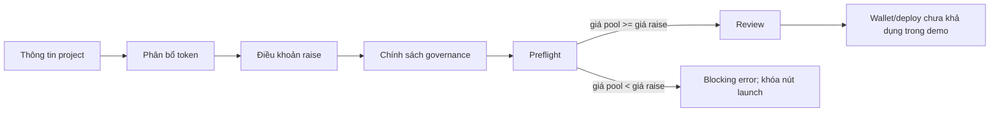
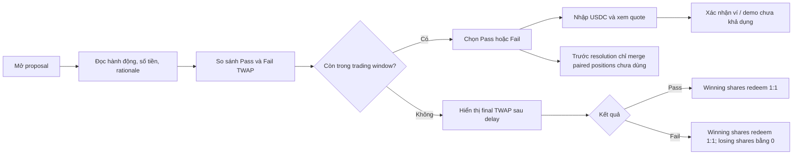

# WolfDAO — Bản đồ page và flow cần hoàn thiện trên Stitch

Tài liệu này chuyển yêu cầu trong bộ docs thành checklist màn hình cho project Stitch. Đây là đặc tả để hoàn thiện canvas hiện có; không khẳng định demo đã deploy contract hoặc có hoạt động on-chain thật.

## Nguyên tắc sản phẩm và giao diện

- Môi trường hiện tại là Avalanche Fuji testnet (`chainId 43113`). Gắn nhãn mọi số liệu mẫu là demo/minh họa; ghi `Not configured` hoặc `Unavailable in demo` khi chưa có dữ liệu.
- Tuân theo `DESIGN.md`: Schibsted Grotesk cho UI, tabular numerals cho số; Newsreader chỉ dùng cho nội dung biên tập dài. Màu WolfDAO: crimson `#C9363E` cho nhận diện và action chính; canvas `#F5F7FA`, panel `#FFFFFF`, chữ `#14202B`, chữ phụ `#5E6B78`, đường kẻ `#DCE6EE`; Pass `#1C6E8C`, Fail `#C4561D` là màu ngữ nghĩa; agent graphite `#6B6878`.
- Dùng logo WolfDAO trong `apps/web/public/brand/wolfdao-logo.png` cho header và các bề mặt nhận diện; chỉ dùng wolf mark ở kích thước nhỏ.
- Không hiển thị địa chỉ, số dư ví, block height, phí, lịch sử giao dịch, RPC latency, volume, số lượng hoạt động, win rate, bond hay execution receipt tự tạo như dữ liệu thật. Không dùng trạng thái `Approved/Passed/Executed` khi market vẫn đang giao dịch.
- Dùng thống nhất navigation và cách đặt trạng thái. Thiết kế các state cần thiết: loading, empty, unavailable, validation blocked, disconnected wallet, pending, resolved.

## Danh sách route và màn hình

| Route | Màn hình | Nội dung và state cần có |
| --- | --- | --- |
| `/` | Explore | Banner demo/Fuji; EduChain là project duy nhất có dữ liệu; card Proposal #3 mang trạng thái `Trading`; Pass/Fail TWAP gắn nhãn demo; liên kết rõ sang proposal và raise. Bỏ counter tổng và project không có trong docs. |
| `/create` | Wizard tạo project | Thông tin cơ bản → phân bổ token → điều khoản raise → chính sách governance → preflight/review. Dùng tokenomics và điều khoản đã ghi. Preflight phải chặn launch khi giá pool ban đầu thấp hơn giá raise. Không tạo ví, deploy, IPFS, gas hoặc xác nhận contract giả. |
| `/p/[id]` | Tổng quan EduChain | Tóm tắt project và tab con Raise, Treasury, Proposals, Chains. Chỉ dùng facts có trong docs; tách dữ liệu demo khỏi trạng thái live/đã kết nối. |
| `/raise` | Chi tiết raise | Terms, token allocation, duration và ví dụ pro-rata chỉ để minh họa. Nêu rõ invariant giá pool đang chặn launch. Khi chưa deploy/chưa thỏa invariant, nút góp vốn và claim không khả dụng. |
| `/treasury` | Treasury | Chỉ hiển thị số dư demo đã có nguồn và ngân sách vận hành $5,000 USDC/30 ngày. Spend-to-date, lịch sử giao dịch, custody, địa chỉ và policy module chưa biết thì để unavailable. Giải thích khoản chi vượt ngân sách cần futarchy proposal. |
| `/proposals` | Danh sách proposal | Proposal #3 là market active duy nhất đã có dữ liệu trong demo. Proposal khác chỉ xuất hiện khi status có nguồn. Tách `Trading`, `Pending resolution`, `Passed`, `Failed`; không suy ra kết quả từ giá hiện tại. |
| `/chains` | Sơ đồ chain | Fuji C-Chain là môi trường demo được ghi nhận. EduChain L1 ID, RPC, explorer, contract, relayer và bridge để `Not configured` nếu docs không cung cấp. Chỉ mô tả Proposal #4 là yêu cầu: tăng match reward 10 → 15 wEDU, gated by Pass; ICM/Teleporter và ICTT là các primitive đã nêu trong docs. |
| `/propose` | Tạo proposal | Flow 4 bước: mô tả hành động → đặt số tiền/tham số → xem điều kiện market Pass/Fail → review và submit. Wallet signature/transaction là unavailable hoặc simulated trong demo; không tạo tx ID giả. |
| `/proposal/[gov]/[id]` | Chi tiết decision market | Màn hình giao dịch chính. Đặt nội dung quyết định và trạng thái phía trên market. Hiển thị Pass/Fail TWAP, chart có nhãn demo, threshold, thời gian giao dịch còn lại và trade panel. Tách rationale, trade history và vị thế người dùng thành các phần riêng. |
| `/agents` | Danh sách agent | Sage #41 score 81.4; Hawk #42 score 74.9 và demo PnL +$212; Hawk-Cautious #43 score 68.2; Tide #44 market maker. Gắn nhãn demo; không thêm win rate, bond, attestation hay lịch sử chưa có nguồn. |
| `/agents/[agentId]` | Chi tiết agent | Identity, score/role đã ghi nhận và khu vực activity/analysis gọn. Telemetry, attestation, wallet, performance history chưa có nguồn thì để `Unavailable in demo`. |
| `/agents/register` | Đăng ký agent | Chỉ dùng trường ERC-8004 có trong docs và liên kết ví tùy chọn. Có validation, review, disconnected, pending, success/error; không tự tạo agent ID, bond bắt buộc, model attestation hay xác nhận on-chain. |
| `/portfolio` | Portfolio | Mặc định là trạng thái chưa kết nối ví. Sau khi kết nối, chỉ hiển thị holdings đã được index. Phân biệt empty, loading, unavailable. Không điền sẵn holdings mẫu hoặc bật claim/refund/redeem nếu chưa xác minh eligibility. |
| `/about` | Futarchy hoạt động thế nào | Giải thích Raise → treasury bị khóa → decision market Pass/Fail → resolution/execution. Dùng FAQ đã có về không có giao dịch, founder pay, agents và gambling. Bỏ công thức, oracle window và claim deployment chưa được nguồn xác nhận. |
| Modal trong proposal | Mở khóa báo cáo x402 | Giá $0.05 USDC trên Fuji; các bước request → authorization → pending → unlocked, kèm lỗi có thể retry. Nếu chưa có integration thì ghi rõ giao dịch/report unavailable trong demo. |

## Hành trình người dùng quan trọng

### Tạo project và kiểm tra điều kiện raise

Điều khoản EduChain: tổng 10,000,000 EDU; public sale 5,000,000 (50%), treasury 2,000,000 (20%), liquidity 1,500,000 (15%), founders 1,500,000 (15%); minimum raise $50,000; hard cap $200,000; cap price $0.04 USDC/EDU; dự kiến đưa 20% USDC raise vào pool ban đầu; thời lượng production 3 ngày / demo 10 phút.

Preflight ở hard cap hiện bị chặn theo docs: 20% của $200,000 là $40,000; ghép với 1,500,000 EDU cho giá pool ban đầu khoảng $0.0267/EDU, thấp hơn giá raise $0.04. Hiển thị phép tính và khóa launch đến khi điều chỉnh allocation. Không ghi invariant là đã validate.

Ví dụ oversubscription chỉ để minh họa: tổng đóng góp giả định $260,000 trên cap $200,000 thì $200,000 được nhận và $60,000 hoàn lại. Khoản góp giả định $1,000 thì $769.23 được nhận, $230.77 hoàn lại và khoảng 19,230.75 EDU tại giá $0.04.

### Decision market và resolution

Proposal #3: yêu cầu chi $30,000 USDC cho marketing; trạng thái hiện tại `Trading`; demo window 15 phút; warmup 30 giây; TWAP delay 3 phút; threshold +3%; Pass $0.071 / Fail $0.038 là giá trị demo và không chứng minh kết quả cuối. Phí 30 bps và minimum LP $50,000 là demo parameters, không phải số dư người dùng hay telemetry pool live. Đến khi trading window đóng và TWAP được finalize, trạng thái phải là `Pending`.

Không có nhánh hoàn tiền toàn bộ cho vị thế thua. Trước resolution chỉ merge paired positions chưa dùng; sau resolution winning shares redeem 1:1, losing shares redeem 0.

### Mở báo cáo x402

Request báo cáo giá $0.05 trên Fuji → wallet authorization → pending → mở báo cáo. State lỗi phải nói chưa xác nhận charge/unlock và cho retry. Không mở nội dung báo cáo trước state `unlocked`.

## Tham chiếu cấu trúc market

Dùng cấu trúc thông tin từ trang decision của MetaDAO trên Solana làm tham khảo: trạng thái market và final TWAP Pass/Fail trước; giải thích resolution dùng TWAP chứ không dùng last trade; summary/rationale; instructions; trade history; cuối cùng là vị thế và thao tác ví. Với market WolfDAO đang chạy, thay `Final TWAP` bằng current demo TWAP có nhãn và trạng thái `Pending`; chỉ hiện final TWAP sau bước resolution đã ghi trong docs. Không đưa chain data, proposal facts, volume, liquidity hay token mechanics của Solana sang WolfDAO.

Nguồn đã xem: [MetaDAO SOLO-004 decision market](https://metadao.fi/decisions/solo-004).

## Checklist hoàn tất canvas Stitch

- Mỗi route trong bảng có một màn hình chính; flow có kết quả khác nhau đáng kể có state riêng hoặc biến thể state nhìn thấy rõ.
- Sửa khung hiện có ngay trên canvas nếu đã đại diện cho route; không tạo bản duplicate chỉ để thay thế preview cũ.
- Mỗi khung giữ header WolfDAO với logo nhất quán, demo badge, project context và navigation đúng cấp.
- Không còn số liệu giả trông như live trong label, bảng, chart axis hoặc footer.
- CTA thể hiện rõ validation, wallet confirmation, pending, success và lỗi retry; hành động demo chưa khả dụng phải bị khóa và giải thích.
- Resolution dựa trên final TWAP sau window và delay đã nêu; không dựa trên spread tạm thời hay last trade.
